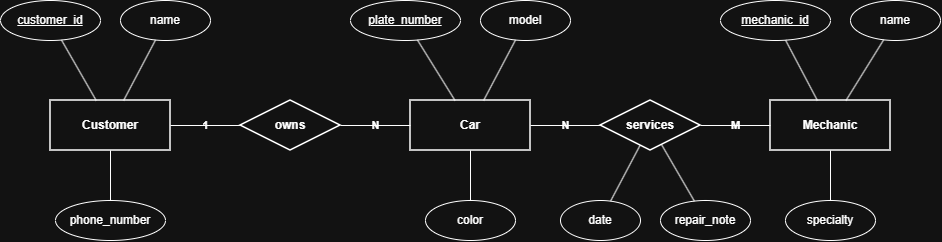

# INFOMAN1 – Week 2 Lab: Conceptual ERD Case Study
**Name:** Owen Ezekiel A. Anchola
**Student ID:** 2511003 
**Section:** BSCS-II

## Task 1 — Candidate Entities

| Entity | Justification |
|---|---|
| Customer | The scenario mentions the shop has many customers who bring in cars, so a customer is an independent person we need to keep track of rather than just a descriptive attribute. |
| Car | Cars have their own distinct details like plate number, model, and color, which makes Car an independent physical object in the system. |
| Mechanic | The shop employs several mechanics with their own names and specialties, so a mechanic is an individual person who performs the repair work. |

## Task 2 — Attributes per Entity

### Customer
- Primary Key: customer_id
- Attributes:
  - customer_id — Domain: integer (numeric ID)
  - name — Domain: text
  - phone_number — Domain: text

### Car
- Primary Key: plate_number
- Attributes:
  - plate_number — Domain: text (alphanumeric string)
  - model — Domain: text
  - color — Domain: text

### Mechanic
- Primary Key: mechanic_id
- Attributes:
  - mechanic_id — Domain: integer (numeric ID)
  - name — Domain: text
  - specialty — Domain: text

## Task 3 — Relationships

| Relationship (verb phrase) | Between | Cardinality | Checked both directions? |
|---|---|---|---|
| owns | Customer ↔ Car | 1:N | Yes — one customer can bring in one or more cars, but the text specifies each car belongs to exactly one customer. |
| services | Mechanic ↔ Car | M:N | Yes — one mechanic works on many different cars over time, and a single car can get serviced by different mechanics across different visits. |

## Task 4 — Conceptual ERD

Service appointments are represented on the "services" relationship with the date and repair note attributes, which fits how scheduled visits link mechanics and cars together.