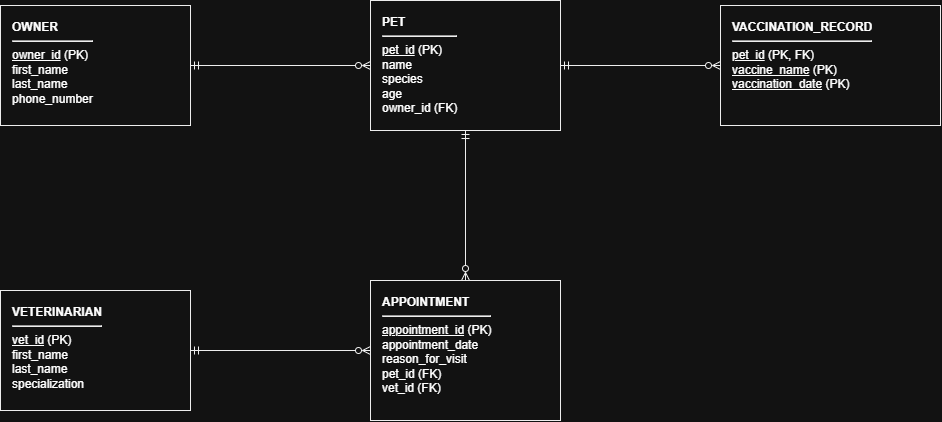

# INFOMAN1 — Week 3 Lab Answers

## Task 1 — Classify Attributes and Identify Weak Entities

### 1. Attribute Classifications
- **Composite Attributes:**
  - `full name` (Pet Owner): The scenario explicitly states this consists of a first name and a last name. We break it into `first_name` and `last_name` in the logical schema so we can search and sort by each part cleanly.
  - `full name` (Veterinarian): Even though the text doesn't spell out "first and last" here, a person's full name is still composite by nature. Splitting it into `first_name` and `last_name` keeps the tables consistent.
- **Multivalued Attributes:**
  - `vaccination history` (Pet): A single pet can have zero, one or multiple vaccination entries over time, with each entry having a vaccine name and a date. You can't store multiple values in a single column in relational design, so this gets moved out into its own table.
- **Derived Attributes:**
  - None: Pet `age` is tracked directly, but there is no date of birth attribute stored to calculate it from. So it has to be stored as a regular attribute.

### 2. Weak Entity Determination
Yes, `vaccination record` should be modeled as a weak entity.

By formal ERD definition, a weak entity is an entity that lacks its own primary key and depends on the existence of an identifying parent entity. The scenario confirms this directly by stating that each record "only makes sense in relation to the specific pet it belongs to meaning it cannot be uniquely identified or looked up on its own." 

A vaccine name and a date are not unique on their own since multiple pets can get the same vaccine on the same day. Because of that the record has to borrow `pet_id` from `Pet` to form its composite primary key (`pet_id`, `vaccine_name`, `vaccination_date`). If a pet gets removed, its vaccination history has no meaning and can't exist by itself.

---

## Task 2 — Specify Participation Constraints

### 1. Owner – Pet
- **Scenario Statement:** *"A pet owner, identified by an owner ID, full name (consisting of first name and last name), and phone number, is not required to have any pets on file at a given time, but every pet must belong to exactly one owner."*
- **Owner Side (looking toward Owner):**
  - Inner (Participation): Mandatory (1)
  - Outer (Cardinality): One (1)
  - Crow's Foot Symbol: Mandatory One (`||`)
  - Meaning: Every pet must belong to exactly one owner.
- **Pet Side (looking toward Pet):**
  - Inner (Participation): Optional (0)
  - Outer (Cardinality): Many (*)
  - Crow's Foot Symbol: Optional Many (`0<`)
  - Meaning: An owner does not need to have a pet on file, but they can own several pets.

### 2. Pet – Appointment
- **Scenario Statement:** *"Every appointment record tracks an appointment ID, appointment date, and reason for visit, and it must specify exactly one veterinarian and exactly one pet—an appointment cannot exist without both."*
- **Pet Side (looking toward Pet):**
  - Inner (Participation): Mandatory (1)
  - Outer (Cardinality): One (1)
  - Crow's Foot Symbol: Mandatory One (`||`)
  - Meaning: An appointment cannot exist without being tied to exactly one pet.
- **Appointment Side (looking toward Appointment):**
  - Inner (Participation): Optional (0)
  - Outer (Cardinality): Many (*)
  - Crow's Foot Symbol: Optional Many (`0<`)
  - Meaning: A pet can be registered in the clinic without having any appointments yet, or they can have multiple appointments over time.

### 3. Veterinarian – Appointment
- **Scenario Statement:** *"A veterinarian, identified by a vet ID, full name, and specialization, can conduct multiple appointments over time or none at all."* and *"...it must specify exactly one veterinarian and exactly one pet—an appointment cannot exist without both."*
- **Veterinarian Side (looking toward Veterinarian):**
  - Inner (Participation): Mandatory (1)
  - Outer (Cardinality): One (1)
  - Crow's Foot Symbol: Mandatory One (`||`)
  - Meaning: Every appointment record must point to exactly one veterinarian.
- **Appointment Side (looking toward Appointment):**
  - Inner (Participation): Optional (0)
  - Outer (Cardinality): Many (*)
  - Crow's Foot Symbol: Optional Many (`0<`)
  - Meaning: A vet can have zero appointments scheduled or conduct many appointments.

### 4. Pet – Vaccination Record
- **Scenario Statement:** *"...a pet may have zero, one, or several vaccination records, and each vaccination record only makes sense in relation to the specific pet it belongs to, meaning it cannot be uniquely identified or looked up on its own."*
- **Pet Side (looking toward Pet):**
  - Inner (Participation): Mandatory (1)
  - Outer (Cardinality): One (1)
  - Crow's Foot Symbol: Mandatory One (`||`)
  - Meaning: A vaccination record cannot exist without referencing the specific pet it belongs to.
- **Vaccination Record Side (looking toward Vaccination Record):**
  - Inner (Participation): Optional (0)
  - Outer (Cardinality): Many (*)
  - Crow's Foot Symbol: Optional Many (`0<`)
  - Meaning: A pet can have zero vaccination records on file, or they can have several.

---

## Task 3 — Build the Logical ERD

*Design notes on the ERD:*
- The weak entity `vaccination_record` uses a composite primary key made of `pet_id` (FK from `pet`), `vaccine_name`, and `vaccination_date`.
- The many-to-many relationship between pets and vets is resolved by the `appointment` entity.
- Composite full names are broken into `first_name` and `last_name`.
- Multivalued vaccination history is resolved into the `vaccination_record` table.

---

## Task 4 — Translate to Relational Schema Notation

owner(<u>owner_id</u>, first_name, last_name, phone_number)

pet(<u>pet_id</u>, name, species, age, owner_id*)
*Note: owner_id references owner(owner_id)*

veterinarian(<u>vet_id</u>, first_name, last_name, specialization)

appointment(<u>appointment_id</u>, appointment_date, reason_for_visit, pet_id*, vet_id*)
*Note: pet_id references pet(pet_id), vet_id references veterinarian(vet_id)*

vaccination_record(<u>pet_id*</u>, <u>vaccine_name</u>, <u>vaccination_date</u>)
*Note: pet_id references pet(pet_id)*

---

## Task 5 — Key Justification & Schema Validation

### 1. Key Justifications

- **`owner` Table (Surrogate Key: `owner_id`):**
  We picked a surrogate key here because natural candidate keys like phone number or full name aren't reliable. People change phone numbers pretty often, and family members can share the same exact number. Full names aren't unique either. If we used a phone number as the primary key and someone updated it, we'd have to update foreign keys across other tables. A surrogate key like `owner_id` is an arbitrary number that never changes, which keeps foreign key references stable.

- **`vaccination_record` Table (Composite Natural / Foreign Key: `pet_id`, `vaccine_name`, `vaccination_date`):**
  For this table, we used a composite key rather than inventing an artificial surrogate ID like `vaccination_id`. The scenario says a vaccination record cannot be identified on its own and only makes sense for a specific pet. Combining `pet_id` with `vaccine_name` and `vaccination_date` uniquely identifies every shot. And it stops duplicate entries from being made if someone accidentally tries to log the exact same vaccine for the same pet on the same day. Adding an extra surrogate key here just isn't needed.

### 2. Schema Validation (Line-by-Line Review)

- **Scenario Statement:** *"A veterinary clinic requires a database system to track pet owners, pets, veterinarians, appointments, and vaccinations."*
  - **Schema Implementation:** Represented by five distinct tables: `owner`, `pet`, `veterinarian`, `appointment`, and `vaccination_record`.

- **Scenario Statement:** *"A pet owner, identified by an owner ID, full name (consisting of first name and last name), and phone number, is not required to have any pets on file at a given time, but every pet must belong to exactly one owner."*
  - **Schema Implementation:** Represented by `owner(owner_id, first_name, last_name, phone_number)` and `pet(..., owner_id*)`. The foreign key `owner_id` in `pet` cannot be null, enforcing that every pet belongs to an owner. The relationship allows an owner to exist without having pets (optional participation).

- **Scenario Statement:** *"A pet has a pet ID, name, species, and age."*
  - **Schema Implementation:** Represented by `pet(pet_id, name, species, age, ...)`.

- **Scenario Statement:** *"Every appointment record tracks an appointment ID, appointment date, and reason for visit, and it must specify exactly one veterinarian and exactly one pet—an appointment cannot exist without both."*
  - **Schema Implementation:** Represented by `appointment(appointment_id, appointment_date, reason_for_visit, pet_id*, vet_id*)`. Both foreign keys are mandatory, meaning an appointment cannot be saved without referencing a pet and a vet.

- **Scenario Statement:** *"A veterinarian, identified by a vet ID, full name, and specialization, can conduct multiple appointments over time or none at all."*
  - **Schema Implementation:** Represented by `veterinarian(vet_id, first_name, last_name, specialization)`. The relationship between `veterinarian` and `appointment` is optional on the vet's side, so a vet can exist with zero appointments.

- **Scenario Statement:** *"In addition, the clinic tracks each pet's vaccination history, consisting of a vaccine name and vaccination date; a pet may have zero, one, or several vaccination records, and each vaccination record only makes sense in relation to the specific pet it belongs to, meaning it cannot be uniquely identified or looked up on its own."*
  - **Schema Implementation:** Represented by `vaccination_record(pet_id*, vaccine_name, vaccination_date)`. The table uses `pet_id` from `pet` as both a foreign key and part of its composite primary key. The relationship is optional on the pet side (0..*) and mandatory on the vaccination record side (1..1).

---

## Self-Check

- [x] All tasks committed with individual, meaningful commit messages
- [x] All files placed inside `week3/`
- [x] This file completed `answers.md`
- [x] Repository link pasted into Moodle (no files uploaded)